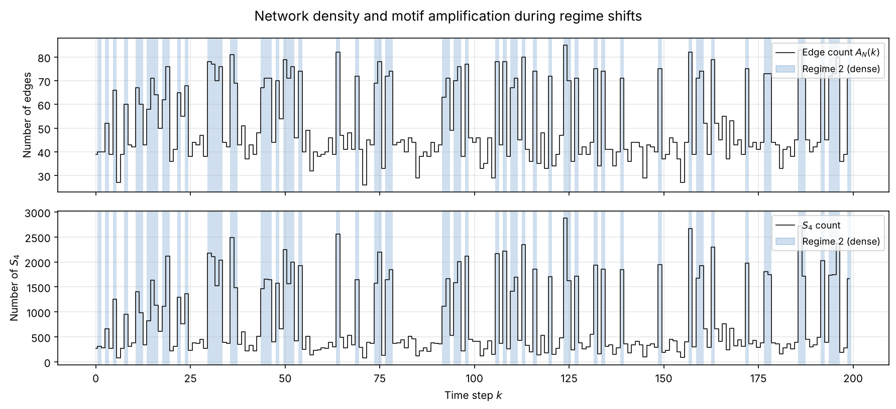
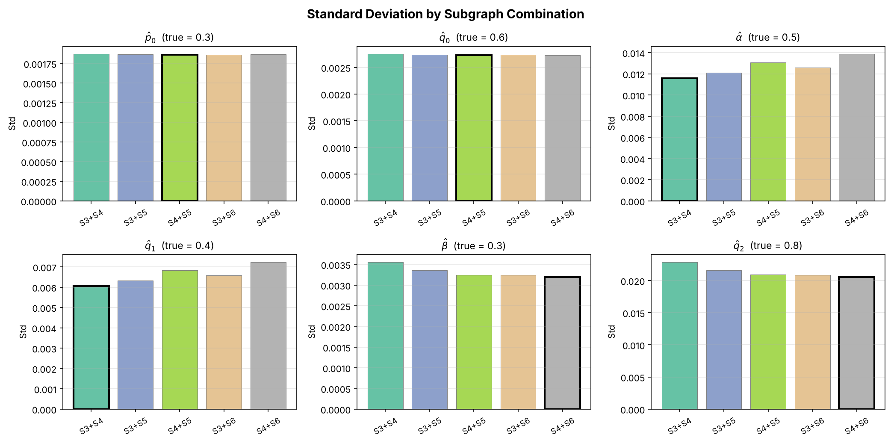

# Motif selection for inference in regime-switching dynamic random graphs

Code of the project *Motif Selection for Inference in Regime-Switching Dynamic Random Graphs*
(Giacomo Grossi, course project for COMP 459/559 – Machine Learning with Graphs, Rice University,
Spring 2026, with Prof. Arlei Silva). The report is in
[`docs/report.pdf`](docs/report.pdf).

Two dynamic Erdős–Rényi graphs on N vertices evolve in parallel: in graph i every vertex pair is
switched on for a time X<sub>i</sub> and off for a time Y<sub>i</sub>, again and again. A hidden
regime process alternates between the two graphs with sojourn times Z<sub>1</sub>, Z<sub>2</sub>,
and at each time one only sees **aggregate subgraph counts** of the current graph. Following
Mandjes and Wang (2023, 2025), the on-, off- and sojourn-time distributions are estimated by the
**method of moments**, in two steps:

1. the snapshot means of the edge count and of two star counts give the regime probability
   π<sub>1</sub> and the edge densities ϱ<sub>1</sub>, ϱ<sub>2</sub>;
2. the lag-one cross moments E S<sub>N,ℓ</sub>(k) S<sub>N,ℓ</sub>(k+1) give E X<sub>1</sub>,
   E X<sub>2</sub>, E Z<sub>1</sub>, and from them all six parameters.

This repository is a Python implementation with stars only, and asks **which pair of star sizes
gives the most precise estimates**, depending on how dense the two regimes are. An ℓ-star
contributes ϱ<sup>ℓ−1</sup> to the moments, so larger stars amplify the dense regime and fade in
the sparse one:



## Results

N = 15 vertices, T = 100,000 time steps, R = 200 simulated trajectories per scenario. On-times
are Weibull, W(1.5, α) and W(1.5, β) with α = 0.5, β = 0.3; regime sojourns are geometric,
G(p<sub>0</sub>) and G(q<sub>0</sub>) with p<sub>0</sub> = 0.3, q<sub>0</sub> = 0.6; off-times are
geometric, G(q<sub>1</sub>) and G(q<sub>2</sub>), and set the density. The table gives the standard
deviation of each estimate across trajectories, with the smallest in bold.

**Scenario A, asymmetric (q<sub>1</sub> = 0.4, q<sub>2</sub> = 0.8)**

| Parameter | True | S3 + S4 | S3 + S5 | S4 + S5 | S3 + S6 | S4 + S6 |
|---|---|---|---|---|---|---|
| p<sub>0</sub> | 0.3 | **0.0019** | **0.0019** | **0.0019** | **0.0019** | **0.0019** |
| q<sub>0</sub> | 0.6 | 0.0028 | **0.0027** | **0.0027** | **0.0027** | **0.0027** |
| α | 0.5 | **0.0116** | 0.0121 | 0.0131 | 0.0126 | 0.0139 |
| q<sub>1</sub> | 0.4 | **0.0061** | 0.0063 | 0.0068 | 0.0066 | 0.0072 |
| β | 0.3 | 0.0036 | 0.0034 | 0.0033 | **0.0032** | **0.0032** |
| q<sub>2</sub> | 0.8 | 0.0229 | 0.0216 | 0.0209 | 0.0209 | **0.0205** |

**Scenario B, sparse (q<sub>1</sub> = 0.1, q<sub>2</sub> = 0.15)**

| Parameter | True | S3 + S4 | S3 + S5 | S4 + S5 | S3 + S6 | S4 + S6 |
|---|---|---|---|---|---|---|
| p<sub>0</sub> | 0.3 | **0.0028** | 0.0029 | 0.0032 | 0.0032 | 0.0037 |
| q<sub>0</sub> | 0.6 | **0.0039** | 0.0043 | 0.0049 | 0.0048 | 0.0058 |
| α | 0.5 | **0.0234** | 0.0276 | 0.0389 | 0.0333 | 0.0526 |
| q<sub>1</sub> | 0.1 | **0.0030** | 0.0035 | 0.0049 | 0.0042 | 0.0064 |
| β | 0.3 | **0.0068** | **0.0068** | 0.0069 | 0.0072 | 0.0075 |
| q<sub>2</sub> | 0.15 | 0.0079 | **0.0078** | 0.0080 | 0.0082 | 0.0086 |

**Scenario C, dense (q<sub>1</sub> = 0.9, q<sub>2</sub> = 0.95)**

| Parameter | True | S3 + S4 | S3 + S5 | S4 + S5 | S3 + S6 | S4 + S6 |
|---|---|---|---|---|---|---|
| p<sub>0</sub> | 0.3 | 0.0044 | 0.0044 | **0.0038** | 0.0043 | 0.0043 |
| q<sub>0</sub> | 0.6 | 0.0054 | **0.0051** | 0.0054 | **0.0051** | 0.0053 |
| α | 0.5 | 0.0072 | 0.0065 | **0.0061** | 0.0065 | 0.0064 |
| q<sub>1</sub> | 0.9 | 0.0077 | 0.0071 | **0.0066** | 0.0070 | 0.0069 |
| β | 0.3 | 0.0044 | 0.0044 | **0.0038** | 0.0044 | 0.0044 |
| q<sub>2</sub> | 0.95 | 0.0340 | 0.0348 | **0.0296** | 0.0342 | 0.0340 |
| *converged* | | *151/200* | *171/200* | *131/200* | *190/200* | *165/200* |

- **Sparse regime** (scenario A, graph 1; scenario B): the smallest stars, S<sub>3</sub> + S<sub>4</sub>,
  are the most precise, and in scenario B adding S<sub>6</sub> more than doubles the standard
  deviation of α.
- **Dense regime** (scenario A, graph 2): larger stars help, and S<sub>4</sub> + S<sub>6</sub> gives
  the smallest standard deviation for β and q<sub>2</sub>.
- **Scenario C** needs care: the estimator does not converge on every trajectory, and how often it
  converges depends on the pair of stars (from 131 to 190 out of 200). The standard deviations are
  computed on different subsets of trajectories, so the pairs are not compared on the same data.



The numbers above come from this code; they are close to Table 2 of the report but not identical
(e.g. 0.0116 against 0.0117 for α with S<sub>3</sub> + S<sub>4</sub> in scenario A), because the
original script did not seed the random generator of the compiled simulation (see below).

## Repository

| File | Content |
|---|---|
| `dyngraph.py` | simulation (numba), subgraph counts, theoretical moments, two-step estimator |
| `experiment.py` | the Monte Carlo study: scenarios A, B, C, table, figures and JSON results |
| `plot_timeseries.py` | the time-series figure (edges and 4-stars, dense regime shaded) |
| `results/` | JSON results and logs of the three runs above |
| `figures/` | figures of the three runs |
| `docs/report.pdf` | the report |

```bash
pip install -r requirements.txt
python experiment.py --scenario A --quick   # T = 5000, R = 20: about a minute
python experiment.py --scenario A           # T = 100000, R = 200: about 10 minutes per scenario
python plot_timeseries.py
```

## Notes

- **Seeding.** The simulation runs in numba-compiled functions, whose random generator is not
  reached by `np.random.seed` called from Python. `dyngraph.seed_numba` seeds it, so runs are now
  reproducible; with the same `--seed` two runs give identical results.
- The Weibull scale λ = 1.5 is assumed known; the means of the Weibull distributions are computed
  by summing the survival function up to 10,000.
- Each system of moment equations is solved with `fsolve` from a grid of starting points; a
  trajectory on which no starting point converges is dropped for that pair of stars (column
  *converged* above).
- The first duration of each edge and of the regime starts at a uniform point of a fresh duration
  rather than from the exact stationary residual law; with T = 100,000 the effect is negligible.

## References

- M. Mandjes and J. Wang (2023). Estimation of on- and off-time distributions in a dynamic
  Erdős–Rényi random graph. [arXiv:2401.14531](https://arxiv.org/abs/2401.14531).
- M. Mandjes and J. Wang (2025). Inference for dynamic Erdős–Rényi random graphs under regime
  switching.

## License

MIT
